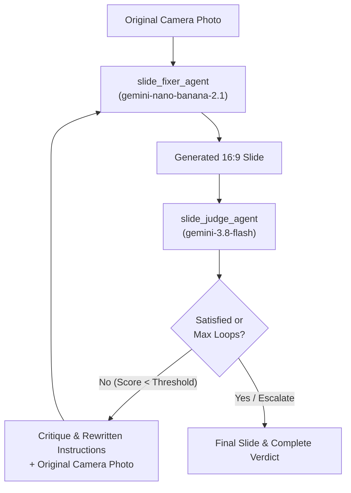

# FixSlidePic

A Micronaut + ADK Java application that transforms skewed, badly lit, or obstructed photographs of conference and university lecture slides into clean, flat 16:9 digital slides as they would appear on a computer screen.

---

## Key Features

- **Perspective & Keystone Rectification**: Automatically identifies the presentation screen boundary and corrects severe angles, off-axis vantage points, and camera tilts into straight 16:9 slides.
- **Lighting & Artifact Neutralization**: Eliminates projector glare, hotspot reflections, uneven room lighting, projector color-wheel rainbow artifacts, and LED display moiré lines.
- **Occlusion Removal & Inpainting**: Seamlessly inpaints podium microphones, attendee silhouettes, speakers' hands, and stage clutter.
- **Code & Typography Reconstruction**: Restores code listings, equations, bullets, and typography with high fidelity and readability.
- **Iterative LLM-as-a-Judge Refinement**: An automated evaluation loop judges text fidelity, geometric alignment, and aesthetics, iterating until quality criteria are satisfied.
- **Degradation-Free Retry Loop**: Refinement iterations always start from the **original photograph** combined with accumulated critique feedback, avoiding compounding image generation artifacts.
- **Real-Time Streaming UI**: Server-Sent Events (SSE) stream the multi-agent progress, intermediate scores, and logs in real time.
- **Comparison Views & PWA**: Interactive Before/After split comparison slider, side-by-side mode, full-resolution export, and installable Progressive Web App (PWA) support.

---

## Architecture & Multi-Agent Workflow

FixSlidePic uses the **Google Agent Development Kit (ADK) for Java** (`com.google.adk:google-adk`) inside a **Micronaut 5** service on **Java 25**.



### Agents

1. **Slide Restorer Sub-Agent (`slide_fixer_agent`)**:
   - Model: **NanoBanana 2.1** (`gemini-nano-banana-2.1`).
   - Crops, deskews, in-paints occlusions, and renders a fresh 16:9 presentation slide canvas.
2. **LLM-as-a-Judge Sub-Agent (`slide_judge_agent`)**:
   - Model: **Gemini 3.8 Flash** (`gemini-3.8-flash`).
   - Compares the restored slide against the original camera capture using a structured JSON schema:
     - `textFidelity`: Accuracy of titles, bullets, and code blocks.
     - `geometryAndCropping`: Alignment, aspect ratio, and boundary cleanup.
     - `themeAndVisualQuality`: Colors, contrast, and visual balance.
     - `overallScore` (1–100) & `satisfied` boolean.
     - `critique` & `rewrittenPromptInstructions`: Actionable prompt enhancements for the next cycle if needed.
3. **Iterative Refinement Loop (`LoopAgent`)**:
   - Coordinates up to **3 iterations** (configurable).
   - Exits early as soon as the judge marks `satisfied = true`.

---

## Getting Started

### Prerequisites

- **Java 25** (e.g. Eclipse Temurin, BellSoft Liberica, or Oracle OpenJDK 25)
- A **Gemini API key** from [Google AI Studio](https://aistudio.google.com/)
- Optional: [just](https://github.com/casey/just) command runner

### Running Locally

1. Export your Gemini API key:
   ```bash
   export GEMINI_API_KEY="your-gemini-api-key"
   # or
   export GOOGLE_API_KEY="your-gemini-api-key"
   ```

2. Start the Micronaut server:
   ```bash
   ./gradlew run
   # or with just:
   just run
   ```

3. Open [http://localhost:8080](http://localhost:8080) in your browser:
   - Drag-and-drop any lecture or conference slide photograph.
   - Follow the live SSE log as the agents analyze, generate, and evaluate the slide.
   - Use the interactive slider or side-by-side view to inspect the results.
   - Click **Regenerate Slide (Loop Again)** with optional user hints to request further refinements.

---

## Configuration

Configure application settings in `src/main/resources/application.properties` or via environment variables:

| Property | Environment Variable | Default | Description |
| :--- | :--- | :--- | :--- |
| `slide-fixer.image-model` | `SLIDE_FIXER_IMAGE_MODEL` | `gemini-nano-banana-2.1` | Model used for slide reconstruction and image generation |
| `slide-fixer.judge-model` | `SLIDE_FIXER_JUDGE_MODEL` | `gemini-3.8-flash` | Model used for multimodal LLM-as-a-Judge evaluation |
| `slide-fixer.max-iterations` | `SLIDE_FIXER_MAX_ITERATIONS` | `3` | Maximum refinement loop cycles |
| `slide-fixer.output-dir` | `SLIDE_FIXER_OUTPUT_DIR` | `generated-slides` | Storage directory for original and restored images |
| `micronaut.server.port` | `MICRONAUT_SERVER_PORT` | `8080` | HTTP server listening port |

---

## Deployment to Google Cloud Run

The repository includes recipes in `justfile` for single-step deployment to Google Cloud Run without needing local Docker daemon builds:

1. Copy the configuration template:
   ```bash
   cp .env.example .env
   ```
2. Edit `.env` with your Google Cloud Project ID, region, and Gemini API secret reference.
3. Deploy the application:
   ```bash
   just deploy
   ```

### Useful `just` Commands

```bash
just config     # Inspect active deployment configuration
just test       # Run all unit tests
just build      # Build the shadow JAR and stage for deployment
just deploy     # Build and deploy to Cloud Run with domain mapping
just status     # View Cloud Run service status and URL
just logs       # Tail real-time service logs from Cloud Run
```

---

## License

This project is licensed under the Apache License, Version 2.0. See the [LICENSE](LICENSE) file for details.

## Disclaimer

This is not an officially supported Google product. This project is not eligible for the [Google Open Source Software Vulnerability Rewards Program](https://bughunters.google.com/open-source-security).
